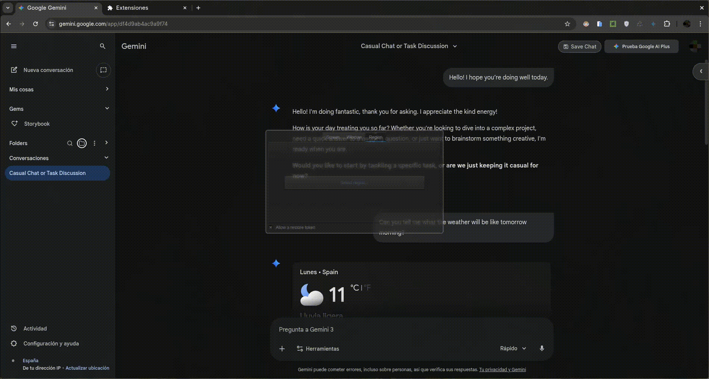

# Gemini Suite Navigation

Una extensión Chromium local-first para mejorar la experiencia de Google Gemini y AI Studio con navegación, organización, exportación y copias de seguridad.

## demo



## 📁 Estructura del Proyecto

```
/
├── README.md                          # Este archivo
├── TODO/                              # Documentación y tareas
│   └── TODO.md                        # Tareas pendientes
└── gemini/                            # Directorio principal de la extensión
    ├── manifest.json                  # Configuración de la extensión
    ├── assets/                        # Recursos estáticos
    │   ├── icons/                     # Iconos de la extensión
    │   └── lib/                       # Bibliotecas de terceros
    └── src/                           # Código fuente organizado
        ├── background/                 # Scripts de background
        ├── content/                    # Content scripts por plataforma
        │   ├── common/                 # Funcionalidades compartidas
        │   ├── gemini/                 # Específico para gemini.google.com
        │   └── aistudio/               # Específico para aistudio.google.com
        └── ui/                         # Componentes UI y estilos
            ├── pages/                   # Páginas HTML
            └── styles/                  # CSS organizado por funcionalidad
```

##  Instalación en Navegadores Chromium

### Requisitos
- Navegador basado en Chromium (Chrome, Edge, Brave, Opera, etc.)
- Acceso a `gemini.google.com` o `aistudio.google.com`

### Pasos de Instalación

1. **Abrir la página de Extensiones**
   ```
   chrome://extensions/
   ```

2. **Activar el Modo Desarrollador**
   - Haz clic en el interruptor "Modo desarrollador" en la esquina superior derecha

3. **Cargar la Extensión**
   - Haz clic en "Cargar descomprimida"
   - Selecciona la carpeta `gemini/` de este repositorio
   - La extensión aparecerá inmediatamente en la lista

4. **Verificar la Instalación**
   - Abre `https://gemini.google.com/app/`
   - La extensión debería estar activa y funcional

5. **Recargar si es Necesario**
   - Después de realizar cambios, haz clic en el botón "Recargar" 🔄 de la extensión
   - O recarga la página de Gemini (F5)

### Actualización de Cambios

Para actualizar la extensión después de modificar el código:
- Ve a `chrome://extensions/`
- Haz clic en 🔄 "Recargar" junto a "Gemini Suite Navigation"
- Recarga la pestaña de Gemini

## Funcionalidades principales

- **Navegación avanzada** entre conversaciones
- **Organización local** con carpetas compatibles, búsqueda, etiquetas, favoritos, recientes y ordenación
- **Opciones y atajos configurables** para tema, barra lateral, confirmaciones, dominios compatibles y comandos
- **Copias de seguridad JSON** de organización y ajustes con importación/exportación local
- **Exportación a PDF** de conversaciones
- **Soporte matemático** con KaTeX
- **Bulk delete protegido** con vista previa, conteos, confirmación y protección de favoritos
- **Sidebar plegable** con modo peek
- **Compatibilidad separada** para Gemini y AI Studio, con selectores centralizados y errores visibles cuando cambia la interfaz

## Privacidad y distribución

Los datos de organización, ajustes y copias de seguridad permanecen en el almacenamiento local del navegador. No se añade analítica ni un servicio remoto. La distribución oficial se realiza únicamente mediante ZIP versionados adjuntos a [GitHub Releases](RELEASE.md); no se publica en Chrome Web Store ni en otra tienda.

Consulta [PRIVACY.md](PRIVACY.md) para permisos, [CONTRIBUTING.md](CONTRIBUTING.md) para desarrollo y [ROADMAP.md](ROADMAP.md) para próximos pasos.

##  Notas para Desarrolladores

- La extensión usa **Manifest V3** (estándar moderno de Chrome)
- No requiere build steps - JavaScript nativo
- Los estilos están modularizados en `src/ui/styles/`
- Los content scripts están separados por plataforma
